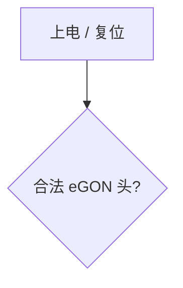

# 博客原始资源 git

本仓库只存放**源材料与 CI 配置**，站点完全由 GitHub Actions 现场构建：
`.github/workflows/deploy.yml` 在 Ubuntu runner 上 `hexo init` 一个临时站点，
装依赖、套配置、复制正文，然后 `hexo deploy` 推送到 `smilelc3.github.io`。

写新文章 → 放进 `markdown/` → push 到 `main`，即自动发布。

> 仓库里**没有任何本地构建脚本**。日常只需要编辑 `markdown/`。

## 目录结构

| 路径 | 说明 |
| --- | --- |
| `markdown/` | 博客正文（唯一需要日常编辑的地方） |
| `images/` | 图片等多媒体资源，兼作图床 |
| `deploy/` | hexo 定制化：两个 `yq` 配置脚本 + 自带的 mermaid 插件 |
| `.github/workflows/` | CI：构建与部署 |

## CI 的构建步骤（`deploy.yml`）

1. `hexo init` 生成临时站点，安装主题与依赖
2. 安装本站自带的插件（`npm install ./deploy/hexo-mermaid-diagram`）
3. 用 `deploy/_config.yml_modify.sh` / `_config.next.yml_modify.sh` 套定制化配置
4. 复制 `markdown/` 与 `deploy/CNAME` 进站点，编译 wasm 小工具到 `source/js/`
5. `hexo clean && hexo deploy --generate`

## 组件构成（零补丁、零自定义前端 JS）

| 能力 | 方案 | 需要补丁吗 |
| --- | --- | --- |
| Markdown 渲染 | `hexo-renderer-markdown-it`（纯 JS，无外部二进制） | 否 |
| 脚注 `[^1]` | `markdown-it-footnote` | 否 |
| 数学公式 | NexT 自带的 MathJax（前端渲染） | 否 |
| Mermaid | 本站的 `deploy/hexo-mermaid-diagram` 插件 | 否 |

**不使用任何补丁** —— 不修改 `node_modules` 里的第三方文件，不注入自定义 JS，
不改主题文件。全部通过「换插件 + 改配置」达成。

## Mermaid：为什么自建了一个插件

NexT 自带的 mermaid 加载器用

```js
document.querySelectorAll('pre > .mermaid')
```

找元素，要求 `.mermaid` 是 `<pre>` 的**子元素**。而社区常用的
`hexo-filter-mermaid-diagrams` 输出的是 `<pre class="mermaid">`（class 在 `<pre>` 上），
选择器命中不到 ⇒ mermaid 库根本不会加载 ⇒ 流程图只显示一段纯文本。

**与其给它打补丁，不如换一个输出结构正确的插件。**
`deploy/hexo-mermaid-diagram` 是本站自带的插件，输出：

```html
<pre><code class="mermaid">flowchart TD …</code></pre>
```

正好命中主题的选择器，于是**主题自带的加载器直接就能渲染**。
它是个标准的 Hexo 插件（`package.json` + `before_post_render` 过滤器），
CI 里用 `npm install ./deploy/hexo-mermaid-diagram` 安装，不是补丁。

> 内容必须是**纯文本**：mermaid 在元素含子元素时读 `innerHTML`、否则读
> `textContent`；`<code>` 里只有文本，走后者，解析正确。

正文照常写标准围栏，常规 Markdown 工具（Typora、VS Code、GitHub）都能预览：

````markdown

````

## 数学公式：主题自带的 MathJax

只需要配置（见 `deploy/_config.next.yml_modify.sh`）：

```yaml
math:
  every_page: true
  mathjax:
    enable: true
    tags: ams
```

正文照常写 `$…$` / `$$…$$`。

### 公式里的 `_` 必须保护起来

正文写 `$\sum^{n}_{i=1}$` 这种形式时，markdown-it 会把 `_` 当成**斜体标记**，
在 MathJax 看到之前就改写成 `<em>`：

```html
$$ \sum^{n}<em>{i=1}{v</em>{i} x_i} $$     ← $ 配对错乱，整块公式退化成纯文本
```

实测这会波及全站 25 处公式。解决办法是插件里的 `lib/math-guard.js`：
它在 markdown-it 的 `emphasis` 规则**之前**把 `$…$` / `$$…$$` 区间整体吃掉、
转成一个纯文本 token，于是 `_` 不再参与标记解析，公式原样留给 MathJax，
而 `*斜体*` 与 `**粗体**` 完全不受影响。

> **不要试图用 `markdown.disable_rules: ["emphasis"]` 解决这个问题。**
> markdown-it 的 `emphasis` 是**核心规则**，同时负责 `*`、`_`、`**`、`__`，
> 关掉会让全站 `**粗体**` 一起失效（此坑已踩过）。

### 早期方案（已弃用）

曾用 `hexo-renderer-pandoc` + MathJax：pandoc 要求 `$` 后不能有空格，
像 `$2^n × 2^n $` 这类会被它当普通文本漏渲染；而且需要外部二进制
（本地 183M、CI 里要单独装）。现已换成 markdown-it。

## 依赖来源：全部走 CDN

本仓库**不本地托管**任何前端库，mermaid 与 MathJax 都取主题 `_vendors.yml`
声明的 cdnjs 资源（带 SRI 校验）：

| 库 | 来源 |
| --- | --- |
| mermaid 11.10.1 | `cdnjs.cloudflare.com/ajax/libs/mermaid/11.10.1/mermaid.min.js` |
| MathJax 4.1.3 | `cdnjs.cloudflare.com/ajax/libs/mathjax/4.1.3/tex-mml-chtml.js` |

代价：CDN 不可达时流程图不显示、公式不渲染（公式源码仍在页面上）。

## 注意事项

- 文章图片走 `raw.githubusercontent.com` 远程地址，需联网访问。
- `deploy/CNAME` 是 UTF-16 编码（沿用上游），hexo 原样复制，无需修改。
- `source/js/` 下的 wasm 小工具由 CI 现场编译，仓库里没有对应的 `js/` 目录。

## 排查提示

- 改完配置若产物没变化，注意 Hexo 的 `db.json` 缓存；CI 每次全新构建，不会遇到。
- 排查公式问题时别只看 HTML —— `_` 强调是在 **markdown 阶段**改写的，
  应检查渲染后的文本里是否残留 `$$` / `\begin{align}`。
- 文档里的 `<pre>` 与 `<code>` 之间**可能有换行**，
  用 `grep '<pre><code'` 这类单行模式搜索会漏判，建议用 Python 解析结构。
- 本地若要预览，需自行搭建 hexo 环境（仓库不提供脚本）。
